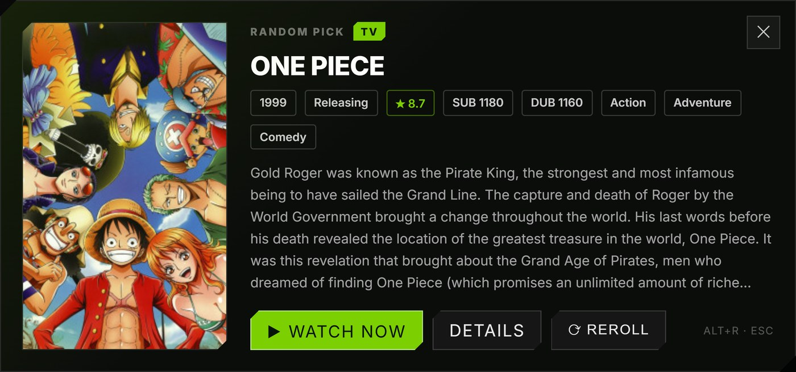
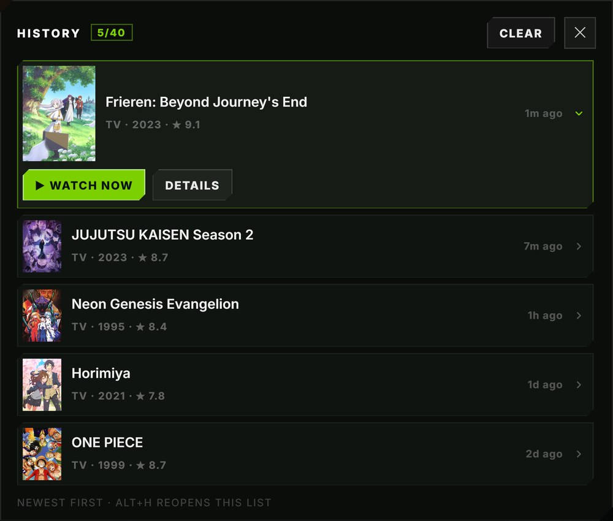

# Re:ANIME Random

A small Chrome / Edge extension that adds a **RANDOM** button to [reanime.cz](https://reanime.cz) — one click gives you a random title that is actually watchable, with a preview card styled like the site itself. A second, smaller button keeps your last 40 picks.



## Features

- **Truly playable picks.** A title is only offered if the site reports hosted episodes for it (`subbed > 0 || dubbed > 0`), then the pick is confirmed against the detail endpoint before it is shown.
- **Format filters.** TV and movies are on by default; OVA, ONA and specials are opt-in. Music videos are never offered. Filtering happens server-side, so an excluded format can't sneak in.
- **Minimum rating.** `Any` through `9.0+`. With `Any`, most rolls are obscure back-catalogue titles — the floor is what surfaces shows you've heard of.
- **No repeats.** Nothing in your recent list is served again, and unreleased or unhosted entries are filtered out.
- **History.** Last 40 picks, newest first, with cover art, format, year, rating and how long ago you rolled it. Click a row and it expands in place to show **Watch now** / **Details**, exactly like the random card. One button clears the list.
- **Keyboard driven.** `Alt+R` rolls again, `Alt+H` opens history, `Esc` closes whatever is open.
- **Isolated UI.** The card and history panel render in a shadow root, so the site's CSS can't break them and they can't break the site.



## Install

Works in Chrome, Edge, Brave, Opera and Vivaldi (Manifest V3). Firefox is not supported.

### From a release

1. Download the latest `reanime-random-<version>.zip` from the [Releases](../../releases) page.
2. Unzip it somewhere permanent — the browser loads the files from disk, so don't delete the folder afterwards.
3. Open `chrome://extensions` (or `edge://extensions`).
4. Turn on **Developer mode** (top-right).
5. Click **Load unpacked** and select the folder that contains `manifest.json`.
6. Open [reanime.cz](https://reanime.cz) — the dice button appears in the header, left of **Sign In**.

### From source

```bash
git clone https://github.com/Cyhirae/ReAnimeRandom.git
```

Then follow steps 3–6 above, pointing **Load unpacked** at the cloned folder.

After updating files, hit the ↻ reload icon on the extension card in `chrome://extensions` and refresh any open reanime.cz tab.

## Usage

| Action | How |
|---|---|
| Roll a random title | Click **RANDOM** in the header, or `Alt+R` |
| Reroll | The **Reroll** button inside the card, or `Alt+R` |
| Open the player | **Watch now** — always starts at episode 1, on the language track that has servers |
| Open the anime page | **Details** |
| See previous picks | The clock button beside Random, or `Alt+H` |
| Watch something from history | Click a row to expand it, then **Watch now** |
| Close a panel | `Esc`, the ✕, clicking the dimmed backdrop, or choosing **Watch now** / **Details** (they close it as they navigate away) |

The header button collapses to just the dice icon in narrow windows, so it never crowds out **Sign In**.

## Settings

Click the extension icon in the toolbar. There is no Save button — every change is stored immediately (the footer reads *Autosave* and flashes *Saved*). **Reset** restores defaults and clears the recent-picks list.

| Setting | Default | What it does |
|---|---|---|
| Format chips | TV + Movies | `TV`, `Movies`, `OVA`, `ONA`, `Specials` — multi-select; at least one stays on. |
| Skip adult titles | on | Ignores titles the detail endpoint flags as adult. |
| Avoid last 40 picks | on | Won't repeat anything you rolled recently. |
| Minimum rating | Any | `Any` / `5.0+` … `9.0+`. |
| Click behaviour | preview card | Or "Go straight to the player" to skip the card entirely. |

### About high rating floors

At `8.0+` and above the pool is small, so the extension builds a shortlist in one sweep (a few batched requests, cached for 10 minutes) instead of sampling offsets blindly — that's what stops a `9.0+` roll from returning "nothing found". Only a handful of playable titles are rated 9.0+, so repeats are possible at that floor.

## How it works

Everything comes from the site's own public API — no scraping, no third-party service, no account:

- `GET /api/v1/search?q=&format=<FMT>&limit=50&offset=N` enumerates the catalogue. Server-side `format` filtering means unselected formats can never be returned. Catalogue sizes: TV ≈ 5,082 · Movies ≈ 3,639 · OVA ≈ 2,358 · ONA ≈ 3,537 · Specials ≈ 1,897.
- Playability is `subbed > 0 || dubbed > 0`, validated against the detail endpoint's `can_watch` over 125 samples with zero disagreements.
- The final pick is confirmed once via `GET /api/v1/anime/<id>` (`can_watch`, `is_adult`, episode counts) before it is rendered.
- Sampling stays inside the offsets where hosted titles are dense (measured per format: ~4,700 TV / ~3,000 Movies / ~1,900 OVA / ~2,400 ONA / ~1,100 Specials) and drifts toward the popular end on retries, because uniform offsets over the whole catalogue land mostly in unhosted back-catalogue.

Requests run from the content script, i.e. as the site itself, so there is no CORS dance and the only host permission needed is `https://reanime.cz/*`.

## Repository layout

```
manifest.json     MV3 manifest (permissions: storage; host: reanime.cz)
content.js        header buttons, picking logic, preview card, history panel
button.css        header button styling (light DOM)
popup.html        settings UI
popup.js          settings load/save, autosave
icons/            icon16/32/48/128.png
docs/             screenshots used in this README
```

Nothing is sent anywhere. The only stored data is your settings, the last 40 picked IDs, and the 40-entry history (title, cover URL, format, year, score, episode count, language, timestamp) in `chrome.storage.local`.

## Notes

- reanime.cz is a SvelteKit app whose header re-renders on navigation; the extension watches the DOM and re-mounts its buttons if they get removed.
- Watch links are built as `/watch/<slug>?ep=1&lang=sub|dub` instead of using the `latest` keyword, so a title always opens reliably at episode 1.

## Disclaimer

Unofficial fan-made tool. Not affiliated with, endorsed by, or supported by Re:ANIME. It hosts no content and streams nothing itself — it only picks a title and links to the site's own pages. Use at your own discretion.

## License

MIT — see [LICENSE](LICENSE).
